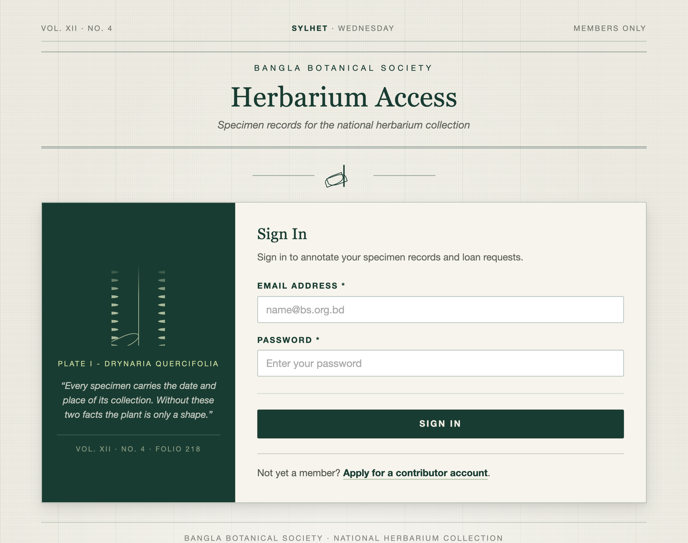
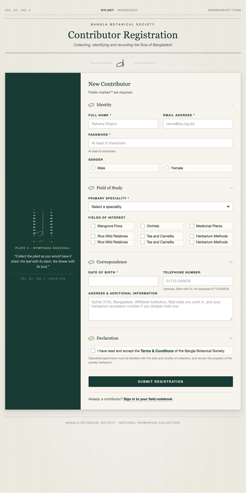

# Bangla Botanical Society - Herbarium Access Portal

Login and Registration forms built with **HTML5 and CSS3 only**, styled as a botanical
research journal published on newsprint.
 

## Screenshots

### Login - desktop



### Registration - desktop



## Project structure

```text
form-project/
├── login.html
├── register.html
├── style.css
├── README.md
└── screenshots/
    ├── login-desktop.png
    └── register-desktop.png
```

Both pages load the same external stylesheet, `style.css`.

## Pages

### `login.html`

| Element | Type | Notes |
|---|---|---|
| Email Address | `input type="email"` | `required`, `autocomplete="email"` |
| Password | `input type="password"` | `required`, `autocomplete="current-password"` |
| Sign In | `button type="submit"` | |
| Apply for a contributor account | link | -> `register.html` |

### `register.html`

| # | Element | Type | Name |
|---|---|---|---|
| 1 | Full Name | `text` | `fullName` |
| 2 | Email Address | `email` | `email` |
| 3 | Password | `password` | `password` |
| 4 | Gender | `radio` (Male, Female) | `gender` |
| 5 | Fields of Interest | `checkbox` x6 | `interests` |
| 6 | Primary Speciality | `select` (6 options) | `speciality` |
| 7 | Date of Birth | `date` | `dateOfBirth` |
| 8 | Telephone Number | `tel` | `telephone` |
| 9 | Address & Additional Information | `textarea` | `address` |
| 10 | Terms & Conditions | `checkbox` | `terms` |
| 11 | Submit Registration | `button type="submit"` | |

Both forms use `method="POST"`. Every field has a matching `for` / `id` pair and a
meaningful `name` attribute.

## Design

| Role | Colour |
|---|---|
| Background | Warm Beige `#EEECE2` |
| Primary | Deep Forest Green `#193C32` |
| Secondary | Sage Green `#A8B99A` |
| Accent | Muted Olive `#C6D69A` |
| Text | Dark Charcoal `#252923` |

- **Typography** - Georgia (serif) for headings, Helvetica Neue (sans-serif) for form fields.
- **Newspaper treatment** - layered CSS gradients give the page a newsprint grain, faint
  column rules and a soft vignette. A dateline strip and double-rule nameplate sit above
  the masthead.
- **Botanical motifs** - the leaf sprig, section markers and fern frond are drawn entirely
  in CSS. No images are used.
- **Layout** - a 32% decorative plate beside a 68% form column, so the form is the focus.

## Responsive behaviour

| Breakpoint | Behaviour |
|---|---|
| > 900px | Two-column layout, paired fields side by side |
| <= 900px | Plate narrows, checkbox grid drops to two columns |
| <= 720px | Single column, plate collapses to a caption band, fern artwork removed |
| <= 420px | Tighter padding, full-width buttons |

## Browser support

Tested in Chrome, Safari and Firefox at desktop, tablet and mobile widths. The layout
prevents horizontal scrolling at every size.

## Notes

- No JavaScript, no frameworks, no external assets.
- The forms have no backend. `action` points at the page itself, so submitting reloads
  the page.
- Telephone numbers are validated against a Bangladesh mobile format, for example
  `01712345678` or `+8801712345678`.
# lc-new
